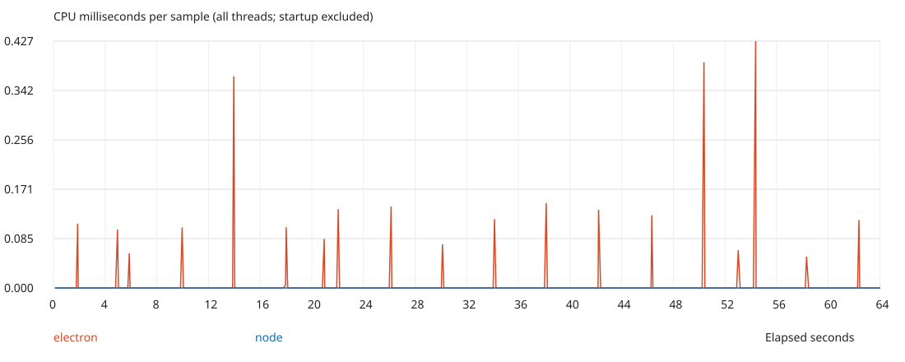

# Electron utility process idle CPU

An Electron utility process wakes up roughly every four seconds, even when its JavaScript has nothing to do. This repo compares it with a standalone Node.js process running the same file:

```js
console.log('hello world');
setTimeout(() => {}, 2147483647);
```

The timeout keeps the process alive for about 25 days. Larger delays such as `9999999999` [overflow to 1ms in Node](https://nodejs.org/api/timers.html#settimeoutcallback-delay-args).

The periodic work comes from Chromium's PartitionAlloc memory reclaimer. It [waits one minute before starting](https://github.com/chromium/chromium/blob/152.0.7977.167/base/allocator/partition_alloc_support.cc), then reclaims memory about every four seconds. The benchmark waits 70 seconds before measuring so it catches this behavior.

## Run in CI

The [GitHub Actions workflow](https://github.com/SimonSiefke/electron-utility-process-idle-cpu/actions/workflows/idle-cpu.yml) runs on Linux ARM64 and Apple Silicon macOS. Push a commit or select **Run workflow** to start it.

Each job matches standalone Node to Electron's embedded Node version, then measures both processes for 64 seconds at 100ms intervals. Sampling happens outside the processes and includes all their threads. Electron's main process and GPU process aren't counted.

CI checks for repeated four-second CPU bursts in Electron and compares its total CPU time with Node. A separate Chromium trace records `MemoryReclaimer::Reclaim` calls in the utility process. See [measure.py](measure.py) for the detection thresholds.

The run summary has the comparison table. Download the artifact for `cpu.svg`, raw samples, runtime versions, and allocator traces. Linux also records syscall traces; macOS records native stacks. These diagnostics run after the CPU measurement.

### Instruction counts

The benchmark also attempts to count retired CPU instructions using Linux `perf` or macOS `proc_pid_rusage`.

Hosted ARM64 VMs can lack working hardware counters. Missing counts appear as `Unavailable`, with a warning. The CPU comparison still runs. Select `require_instructions` when starting the workflow manually to make missing counters fail the job.

Linux counts user-space instructions. macOS counts instructions across the process without a user/kernel filter. Compare Electron with Node within the same job.

## Run locally

Install dependencies and check which Node version Electron embeds:

```sh
npm ci
node node_modules/electron/install.js
ELECTRON_RUN_AS_NODE=1 node_modules/.bin/electron -p process.versions.node
```

Use that Node version for the comparison.

On macOS:

```sh
python3 measure.py --require-reproduction
```

On Linux, install Xvfb, xauth, Electron's system libraries, and optionally `perf` and `strace`. Enable scheduler accounting, then run:

```sh
sudo sysctl kernel.sched_schedstats=1
xvfb-run -a python3 measure.py --require-reproduction
```

Linux may also need `kernel.perf_event_paranoid=-1` for instruction counting and `kernel.yama.ptrace_scope=0` for syscall tracing. CI sets these on its temporary runner.

Results go in `results/`. Use `--trace-seconds 0` to skip diagnostics, or `--require-instructions` to require hardware counters. Run `npm test` to check the measurement analysis.

## Example result

An [Apple Silicon CI run](https://github.com/SimonSiefke/electron-utility-process-idle-cpu/actions/runs/39462195639/job/118764258467) with Electron 44.9.1 and Node 24.22.0 measured:

| Process | CPU time over 64 seconds |
| --- | ---: |
| Electron utility process | 2.88ms |
| Node.js | 0ms |

The allocator trace showed reclaims every 4.01–4.08 seconds. Hardware instruction counters were unavailable on this runner. The [saved results](evidence/macos-arm64/summary.md) include the raw samples and runtime versions.


